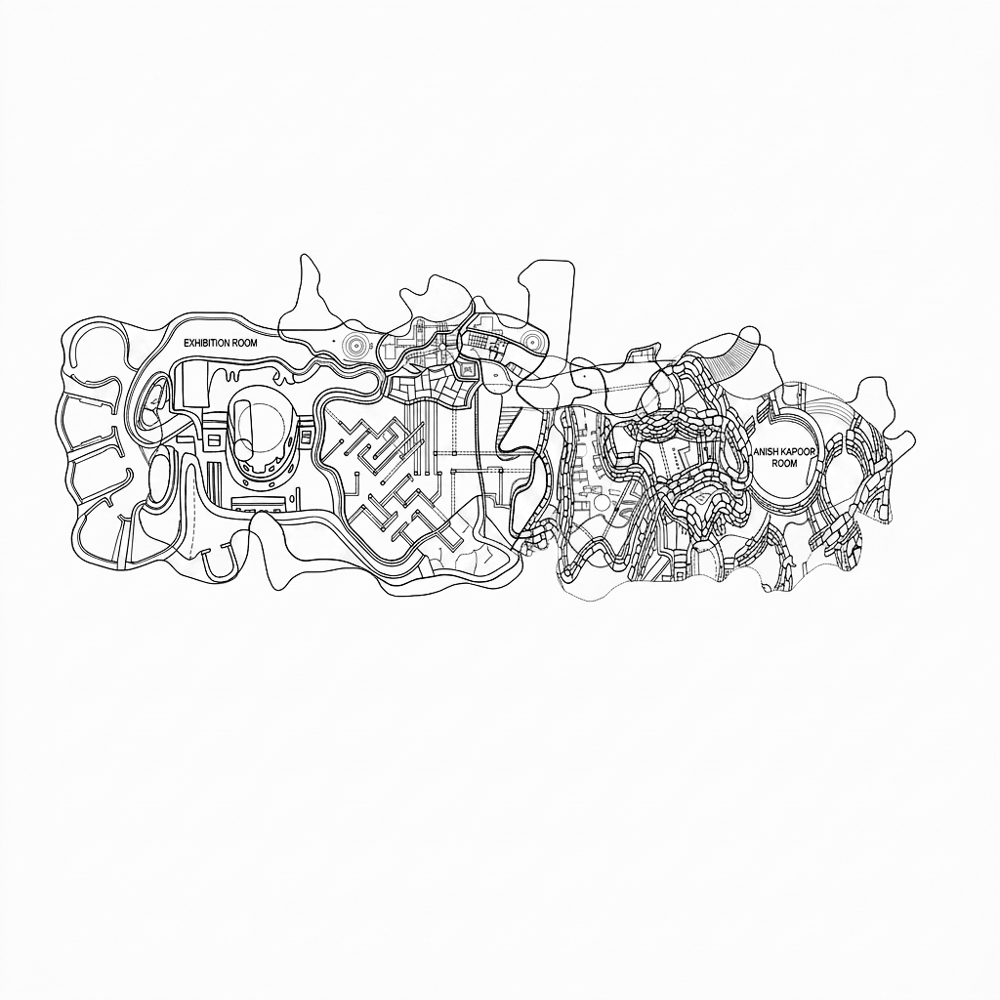
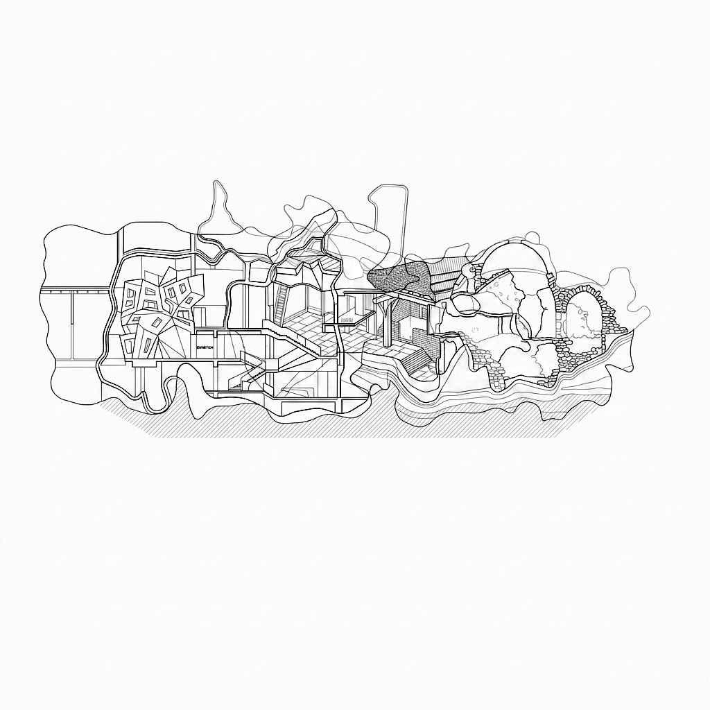

# sequential-drawing

Turns a tagged SVG composition into an architectural drawing by generating **one
region at a time**, each from its own prompt, then unifying the sheet in a final
pass. Uses Google's Gemini image models (Nano Banana).

The point is that the drawing is not one image described once. Each closed region
carries its own semantic tags and gets its own description, so a drystone
enclosure and a concrete cantilever are drawn as different things, in their own
right, in the same sheet — and a region nested inside another inherits its
parent's material and organization as context.

|  |  |
| --- | --- |
|  |  |
| `--mode plan` | `--mode section` |

---

## Install

```bash
pip install -r requirements.txt
```

Get an API key at [aistudio.google.com/apikey](https://aistudio.google.com/apikey),
then set it in your shell. **Never commit it.**

```powershell
$env:GEMINI_API_KEY = "your_key_here"
```

```bash
export GEMINI_API_KEY=your_key_here
```

## Run

See what it would do, without spending a single call:

```bash
python -m sequential_drawing.run examples/composition.svg --dry-run
```

Draw it:

```bash
python -m sequential_drawing.run examples/composition.svg
```

One call per region plus one for the unifying pass, so a 24-region sheet is 25
calls. Output lands beside the SVG in `drawing_<timestamp>/`:

| file | |
| --- | --- |
| `00_base.png` | the starting sheet |
| `NN_<region>.png` | the canvas after each region — the whole sequence |
| `final.png` | all regions drawn |
| `final_restyled.png` | after the unifying pass |
| `plan.json`, `run.json` | every prompt, and what actually ran |

**It is resumable.** Any region already on disk is skipped, so re-run the same
command after a rate limit or a dropped connection and it picks up where it
stopped.

## Options that matter

| flag | |
| --- | --- |
| `--mode plan\|section\|mixed` | horizontal cut, vertical cut, or per-region from its own organization term |
| `--model` | `nano-banana-2` (default), `nano-banana-pro`, `nano-banana-lite`, `nano-banana` |
| `--refs <folder>` | up to 3 style reference drawings |
| `--limit N` | only the first N regions, for a cheap look |
| `--base` | what the first pass starts from — `full`, `lines`, `flat`, `source` |
| `--no-finish` | skip the unifying pass |

Map which region got which prompt:

```bash
python -m sequential_drawing.prompt_map examples/composition.svg --image drawing_*/final_restyled.png
```

---

## Input format

Any SVG with closed paths in groups marked as curated regions — either
`data-reading="curated"`, or an id of the form:

```
curated__frag_07__neoclassical__polished-marble__monumental-mass
```

Optional per-group attributes fill out the prompt: `data-material`,
`data-organization`, `data-gestalt`, `data-surface`, `data-period`.

Two things worth knowing if you edit compositions by hand:

- **Illustrator strips `data-*` attributes on save.** The parser falls back to
  reading tags out of the group id, so keep the ids intact — and keep an
  unedited copy.
- Editors also rewrite paths into compressed relative form. That is handled
  (via `svgpathtools`), but a naive parser will choke on it.

## How it works

1. **Parse and nest.** Regions are read from the SVG and containment is
   *measured* — a region's parent is the tightest earlier region covering at
   least 60% of it. Draw order is big-behind-small, so parents always precede
   children.
2. **One prompt per region**, built from its tags plus its parent's as inherited
   context.
3. **Generate.** Gemini's image models take no binary mask, so the region is
   cropped to its padded bounding box, generated, and composited back **through
   its polygon**. The geometry stays exactly as authored rather than relying on
   the model to respect a boundary. The crop arrives with everything outside the
   region faded and its outline drawn, because a region occupies only ~26% of its
   crop on average and without that the model composes for the square — which is
   how you end up with a rotunda in every region.
4. **Unify.** One whole-frame pass settles the independently-generated regions
   into a single drawing hand. `final.png` is kept alongside so you can compare.

Every returned region is normalised to neutral greyscale. Left alone the models
return warm paper, and because each region is generated from a canvas the
previous ones already tinted, the cast compounds across a run.

## Notes and limits

- **Style references leak.** A whole reference sheet reproduced a distinctive
  plan element almost verbatim. `--ref-mode patches` (the default) crops
  references to 16% texture tiles so mark-making survives and motifs do not.
  It reduces the risk; it does not eliminate it.
- `--mode mixed` uses `SECTION_TERMS` in `geometry.py` — six organization terms
  that imply a vertical condition. On compositions dominated by plan-like terms
  it will look close to `--mode plan`.
- Costs are per image and per model. `nano-banana-pro` is materially more
  expensive than `nano-banana-2`; start with `--limit` before a full sheet.

## Layout

```
sequential_drawing/
  geometry.py     SVG -> regions, nesting, prompts, base sheet.  No model code.
  backend.py      Gemini: crop, generate, composite. Style-reference handling.
  run.py          the driver
  prompt_map.py   keyed region -> prompt map, PNG + CSV + MD
examples/
  composition.svg 24 tagged regions
```
